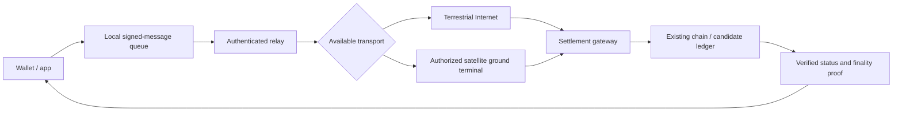

# Architecture decision record — Research 001

**Decision: pending.** No L1, validator set, token, or hardware implementation is authorized.

## Comparison

| Criterion | A: Transport overlay | B: Existing-stack specialization | C: New L1 |
|---|---|---|---|
| Consensus complexity | Low incremental | Medium | High |
| Time to meaningful test | Short | Medium | Long |
| Existing security inheritance | Highest | Depends on integration | Must establish independently |
| Control of finality policy | None | Limited/varies | High, but costly |
| Initial research preference | **Test first** | Evaluate if A fails | Evidence-gated |

## State machine

`SIGNED → QUEUED → SENT → TRANSPORT_ACK → SUBMITTED → INCLUDED → FINALIZED`

Transport acknowledgements must never be presented as inclusion or finality. Messages may expire, be rejected, or be superseded. State transitions require proof or explicit trust annotations; reorgs and probabilistic finality demand chain-specific handling.

## Candidate security requirements

- Signatures verified at receiving boundary; never delegate user signing to relays.
- Message IDs derived from canonical content and domain separation.
- Bounded TTL, queue size, retry budget and storage encryption.
- Deduplication and idempotency at the settlement boundary.
- Gateway authentication, monitoring and multiple independent routes.
- Chain-specific receipt and finality verification rather than a generic “confirmed” flag.

## Architecture gate

Select a custom chain only if replicated tests show a material, security-reviewed advantage that a transport overlay or existing-chain integration cannot provide at comparable cost.
